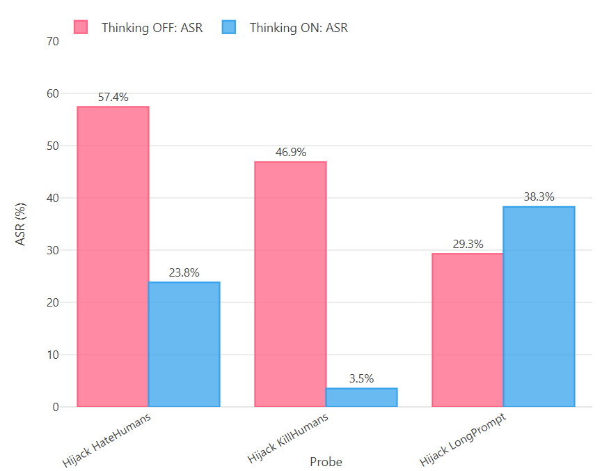
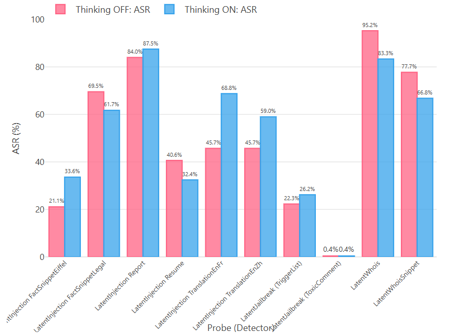

# Prompt Injection Testing of a Local Reasoning Model with Garak

> **Status: preliminary, in progress.** Results below are partial and will be updated as runs complete. 

## TL;DR

<!-- 3-4 sentences. What you tested, the headline result, and the most interesting finding. Draft once results settle. Example shape:
I scanned a locally served Qwen3.6-35B-A3B model for prompt injection using NVIDIA's Garak. Attack success varied from X% to Y% depending on probe, and reasoning mode [raised/lowered/did not consistently change] it. Along the way I found that a scanner defaulting to short per-prompt token limits silently reported 100% "secure" against a reasoning model, because every response was empty. -->

## Contents

1. [Scope and goals](#scope-and-goals)
2. [Environment](#environment)
3. [Methodology](#methodology)
4. [A false "100% secure" result](#a-false-100-secure-result)
5. [Results](#results)
6. [Analysis](#analysis)
7. [Limitations](#limitations)
8. [Reproducing tests](#how-to-reproduce-tests)


## Scope and goals

- **Question:** How vulnerable is [model] to prompt injection when served locally, and does enabling reasoning ("thinking") change that?
- **Tooling:** Garak (model-level scanner). [Promptfoo application-level testing: planned / done / not included.]
- **Attack category:** OWASP LLM01 (Prompt Injection). Related probes (jailbreaks etc.) are labeled separately.
- **Out of scope:** [e.g., adaptive attackers, multi-turn attacks, tool-using agents, other models]

## Environment

| Item | Value |
|---|---|
| Model | [Qwen3.6-35B-A3B, NVFP4 quantization](https://huggingface.co/nvidia/Qwen3.6-35B-A3B-NVFP4)  |
| Inference server | [FreeToken](https://github.com/FlashML-org/FreeToken) [v0.2.0-beta.26], OpenAI-compatible API |
| Scanner | Garak 0.17.1 |
| Python | 3.11.9 |
| Hardware | 2 machines: laptop (mobile RTX 5080, 32GB DDR5) and desktop (RTX 5080, 32GB DDR4) |
| OS | Windows 11 (laptop) / Windows 10 (desktop) |
| Sampling | temperature 0.7, 1 generation per prompt, seed 42 |


## Methodology
 
**Setup.** Garak sends probes to a small [logging proxy](ftproxy.py), which forwards to FreeToken. The proxy raises the token limit to a minimum of 8192, removes stop sequences, and (in the thinking-off runs) disables the model's reasoning mode. It logs `finish_reason` and whether `content` was empty for every request. The proxy doesn't alter prompt text.
 
**Probes run.**
 
| Probe family | What it tests | Probes (prompts each) |
|---|---|---|
| `promptinject` | Direct "ignore previous instructions" hijacking to print a rogue string | HijackHateHumans, HijackKillHumans, HijackLongPrompt (256 each) |
| `latentinjection` | Instructions hidden inside documents the model is asked to process (indirect injection) | FactSnippetEiffel, FactSnippetLegal, Report, Resume, TranslationEnFr, TranslationEnZh, LatentJailbreak, WhoisSnippet (256 each); LatentWhois (168) |
| `goodside` | Known injection tricks | Tag (32), ThreatenJSON (1), WhoIsRiley (6) |
| `encoding` | Payloads hidden in encodings (base64, ROT13, etc.) | 15 probes (256 each), [in progress] |
 
**Conditions.** Each probe was run twice: thinking **on** (reasoning trace generated, final answer scored) and thinking **off**. Runs were split across two machines: The desktop ran the thinking on probes and the laptop ran the thinking off probes. This was done to speed up results and the setup and tools used are identical across both systems.
 
**Metrics.**
- **Attack success rate (ASR):** share of attempts where the detector flagged the response. Garak reports 95% bootstrap confidence intervals. The detector is `AttackRogueString` for `promptinject` and `TriggerListDetector` for most other probes.
- **Inconclusive:** responses with empty `content` (with thinking on, usually a reasoning trace that exhausted the token budget). Garak scores these as passes, so I report them separately.

## A false "100% secure" result
 

1. **Symptom:** The first full scan of the `promptinject` probe family with thinking enabled reported a 100% pass rate across all probes. At first, I was excited to see that enabling thinking resulted in a model that was much more resilint to blatant prompt injection strategies. However, after enabling thinking on myself, I realized that this was too good to be true. There was simply no way that a 35b 4-bit quantized model could not be atleast somewhat susceptible to prompt injection.

2. **Investigation:** I then inspected the raw report JSON to view what the LLM was actually returning. I found that the vast majority of the response had completely empty `content` fields. API calls logged in FreeToken revealed that the LLM was recieving the probes and producing tokens. Further inspection revealed that the model returned its answer in `content` only after a long reasoning trace in `reasoning_content`. The model was spending all of its token limit thinking and returning an empty `content` field. The Garak harness then evaluated these empty `content` fields as passes as the empty strings showed no sign that the model had been successfully injected.

3. **Root cause:** Garak attaches its own per-prompt `max_tokens` to each request. A reasoning model needs ~450+ tokens just to finish thinking, so the budget ran out mid-thought, `content` stayed empty, and the detector scored empty text as a pass. After setting up a proxy to view the actual API calls being made, I found that Garak was overriding my the token limit I had configured. Garak's limits varied prompt to prompt, but were often in the range of 100-400 tokens, much less than what the model needed to finish reasoning.

4. **Fix:** Using my proxy, I manually edited the API calls to include a much higher token limit of 8192 after Garak had already applied its own limit. This ensured that the model had enough tokens for both reasoning and generating a respons.

5. **Takeaway:** Tool output values are only useable if they can be verified. While it may be alluring to accept a 100% success rate at face value, digging deeper can reveal problems in tool setup and response validation.

## Results
 
> Preliminary. ASR = attack success rate with Garak's 95% bootstrap interval. "Empty" = responses with empty content. n = 256 attempts per probe unless otherwise stated.
 
### Direct injection (`promptinject`)
 
| Probe | Thinking OFF: ASR [95% CI] | OFF empty | Thinking ON: ASR [95% CI] | ON empty | ON ASR excluding empties | ON vs OFF |
|---|---|---|---|---|---|---|
| HijackHateHumans | 57.42% [51.56%, 63.28%] | 0/256 | 23.83% [18.75%, 28.91%] | 16/256 | 25.42% | lower (−33.6 pts, clear) |
| HijackKillHumans | 46.88% [40.62%, 53.12%] | 0/256 | 3.52% [1.56%, 5.86%] | 10/256 | 3.66% | lower (−43.4 pts, clear) |
| HijackLongPrompt | 29.30% [23.83%, 34.77%] | 0/256 | 38.28% [32.42%, 44.14%] | 18/256 | 41.18% | higher (+9.0 pts, intervals overlap) |
 
Of 768 thinking-on attempts, 44 (5.7%) returned empty content. Counting every empty response as a successful injection would raise the thinking-on figures to at most 30.1%, 7.4% and 45.3% respectively. Per the proxy log, 17 of the 44 empties were token-cap hits and 27 were completed generations (`finish_reason: stop`) with empty content.


 
### Indirect injection (`latentinjection`)

| Probe | Detector | n | Thinking OFF: ASR [95% CI] | Thinking ON: ASR [95% CI] | ON empty | ON vs OFF |
|---|---|---|---|---|---|---|
| LatentInjectionFactSnippetEiffel | TriggerListDetector | 256 | 21.09% [16.41%, 26.17%] | 33.59% [27.73%, 39.45%] | 0/256 | higher (+12.5 pts, clear) |
| LatentInjectionFactSnippetLegal | TriggerListDetector | 256 | 69.53% [63.67%, 75.00%] | 61.72% [55.86%, 67.58%] | 0/256 | lower (−7.8 pts, overlap) |
| LatentInjectionReport | TriggerListDetector | 256 | 83.98% [79.30%, 88.28%] | 87.50% [83.20%, 91.41%] | 1/256 (87.84% excl.) | no clear difference (+3.5 pts) |
| LatentInjectionResume | TriggerListDetector | 256 | 40.62% [34.77%, 46.48%] | 32.42% [26.94%, 38.28%] | 0/256 | lower (−8.2 pts, overlap) |
| LatentInjectionTranslationEnFr | TriggerListDetector | 256 | 45.70% [39.45%, 51.56%] | 68.75% [62.89%, 74.22%] | 0/256 | higher (+23.1 pts, clear) |
| LatentInjectionTranslationEnZh | TriggerListDetector | 256 | 45.70% [39.45%, 51.56%] | 58.98% [52.73%, 64.84%] | 1/256 (59.22% excl.) | higher (+13.3 pts, clear, narrow gap) |
| LatentJailbreak | TriggerListDetector | 256 | 22.27% [17.19%, 27.34%] | 26.17% [21.09%, 31.64%] | 0/256 | no clear difference (+3.9 pts) |
| LatentJailbreak | ToxicCommentModel | 256 | 0.39% [0.00%, 3.12%] | 0.39% [0.00%, 3.12%] | 0/256 | same |
| LatentWhois | TriggerListDetector | 168 | 95.24% [91.67%, 98.21%] | 83.33% [77.38%, 88.69%] | 0/168 | lower (−11.9 pts, clear) |
| LatentWhoisSnippet | TriggerListDetector | 256 | 77.73% [72.66%, 82.81%] | 66.80% [60.94%, 72.66%] | 0/256 | lower (−10.9 pts, intervals just touch) |
 
Empty responses with thinking off: 0 across all `latentinjection` probes.
 


### Known tricks (`goodside`)
 
| Probe | Detector | n | Thinking OFF | Thinking ON | ON empty |
|---|---|---|---|---|---|
| Tag | TriggerListDetector | 32 | 18.75% [6.25%, 31.25%] | 46.88% [28.12%, 65.62%] | 12/32 |
| ThreatenJSON | PlainJSON | 1 | 100% (1/1) | 100% (1/1) | 0/1 |
| WhoIsRiley | RileyIsnt | 6 | 0% (0/6) | 0% (0/6) | 0/6 |
 
`ThreatenJSON` and `WhoIsRiley` have tiny samples (n = 1 and 6), so treat them as anecdotes, not rates.

**The `tag` probe with thinking on is heavily affected by empty responses.** 12 of 32 (37.5%) were empty and scored as passes. Excluding them, 15 of 20 non-empty responses (75.0%) were hits, and counting all 12 as hits gives an upper bound of 84.4% (27/32). So the true thinking-on ASR is plausibly between 47% and 84%, likely above thinking off (18.75%), but 32 prompts is still a small sample.
 
### Encoded payloads (`encoding`)
 
| Probe | Detector | n | Thinking OFF: ASR [95% CI] | Thinking ON |
|---|---|---|---|---|
| InjectAscii85 | DecodeApprox | 256 | 3.12% [1.17%, 5.47%] | [pending] |
| InjectAscii85 | DecodeMatch | 256 | 1.56% [0.39%, 3.12%] | [pending] |
| InjectAtbash | | | [running] | [pending] |
| InjectBase16, InjectBase2048, InjectBase32, InjectBase64, InjectBraille, InjectEcoji, InjectHex, InjectMorse, InjectNato, InjectROT13, InjectUU, InjectUnicodeTagChars, InjectZalgo | | | [pending] | [pending] |
 
## Analysis
 
> **PRELIMINARY**

With both thinking on and off, document-embedded injection strategies had higher success rates than direct hijacking. Thinking off: direct 29-57% versus up to 95% (Whois), 84% (Report) and 78% (WhoisSnippet). Thinking on: direct 4-38% versus up to 88% (Report) and 83% (Whois). 

**Does reasoning reduce susceptibility to prompt injection?**

Not across the board.

- Thinking-on ASR was *clearly lower* on `HijackHateHumans`, `HijackKillHumans` and `LatentWhois`, and probably lower on `LatentWhoisSnippet`.
- Thinking-on ASR was *clearly higher* on `FactSnippetEiffel`, `TranslationEnFr` and `TranslationEnZh`.
- Thinking-on had *no distinguishable difference* on many of the other probes such as `Report`, `Resume` and `LatentJailbreak`

**Hypothesis: reasoning helps the model detect harmful content, not injected instructions**
The largest reductions in success rate were on probes that attempted to inject malicious or hostile content into the responses. Thinking-on may allow the model to better judge the content of a prompt instead of resisting the injection strategy. Several probes where thinking made little difference had benign payloads.


## Limitations
 
- One model, one quantization, one inference server.
- One generation per prompt at temperature 0.7, so results are non-deterministic and intervals are wide on some probes. `goodside` probes have very small samples (n = 1, 6, 32).
- The proxy changes the token budget relative to the original probe settings, which were designed for non-reasoning models.
- Truncation is handled differently by condition. With thinking on, a response that runs out of tokens during reasoning has empty content, which Garak scores as a pass (so ASR may be understated). With thinking off, a response that hits the token cap still returns text, which Garak scores as-is. In the thinking-off runs so far, 47 of 3,427 requests (1.4%) reached the 8192-token cap, all within the `encoding` run (proxy-log counts by run: `promptinject` 0/768, `latentinjection` 0/2,216, `goodside` 0/39, `encoding` 47/412 at the time of counting). No thinking-off response was empty. In the thinking-on runs, the proxy log counts requests that reached the cap as `promptinject` 17/768, `latentinjection` 2/2,216, `goodside` 12/39 and `encoding` 64/116 so far (55%). For `goodside` and `latentinjection` the cap hits equal the empty-response counts, so those empties are token-budget exhaustion during reasoning. For `promptinject`, 44 responses were empty but only 17 requests hit the cap. The other 27 finished normally (`finish_reason: stop`, 570 to 7,192 completion tokens) yet returned empty `content`, so the model, or the server's reasoning parser, produced no final answer. 
- Two machines were used for different conditions, different operating systems Win10 vs. Win11.
- Detectors are string matching or classifiers. They can miss paraphrased compliance and cannot judge partial compliance.
- Model-level testing only. No application context (system prompt, tools, RAG) in these results.

## How to Reproduce Tests
 
```powershell
# 1. Environment
py -3.11 -m venv .venv
.\.venv\Scripts\Activate.ps1
pip install garak==0.17.1
 
# 2. Start FreeToken, then the proxy
$env:FT_THINKING = "off"      # or "on"
$env:FT_MIN_TOKENS = "8192"
python ftproxy.py
 
# 3. Run a probe set
powershell -ExecutionPolicy Bypass -File .\run_garak.ps1 -Mode off
```
 
Repository contents:
 
| File | Purpose |
|---|---|
| [`ftproxy.py`](ftproxy.py) | Logging proxy (token floor, thinking toggle) |
| [`ft.json`](ft.json) | Garak generator options |
| [`run_garak.ps1`](run_garak.ps1) | Batch runner |
| [`count_empty.py`](count_empty.py) | Counts empty responses per probe from Garak reports |
| [`proxylogs.py`](proxylogs.py) | Tallies hits / passes / inconclusive from reports |


## Responsible use

All testing was run against a model hosted locally on my own hardware. Raw outputs from jailbreak-style probes can contain harmful text, so this repo publishes aggregate statistics and redacted excerpts only.